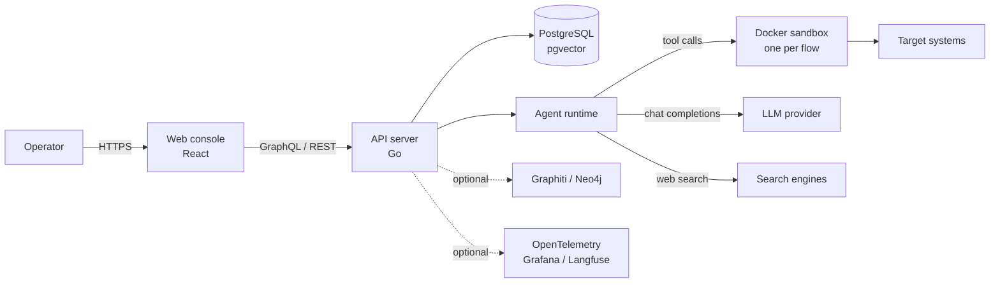

# ARCANA

Autonomous security testing, self-hosted.

ARCANA is a multi-agent platform that plans and runs authorized penetration tests. Give it a target and an objective in plain language: a primary agent splits the work into tasks, specialist agents carry them out with real tools inside isolated Docker sandboxes, and everything they learn is kept in PostgreSQL + pgvector for the next engagement.

> [!WARNING]
> ARCANA drives offensive tooling. Use it only against systems you own or are explicitly authorized to test. The [EULA](EULA.md) sets the acceptable-use terms.

## Contents

- [Capabilities](#capabilities)
- [Architecture](#architecture)
- [Quick start](#quick-start)
- [Providers](#providers)
- [Configuration](#configuration)
- [Using ARCANA](#using-arcana)
- [API](#api)
- [Development](#development)
- [Utilities](#utilities)
- [Security](#security)
- [License](#license)

## Capabilities

- **Autonomous or human-steered.** Run an automation flow end to end, or an assistant flow where you redirect the investigation between steps; assistant flows can delegate to sub-agents.
- **Specialist agents.** A primary agent orchestrates pentester, coder, searcher, installer, memorist, adviser, reflector, reporter, enricher, summarizer and tool-call-fixer roles.
- **Real tooling.** 20+ security tools (nmap, Metasploit, sqlmap, and more) alongside terminal, code, browser, web search, memory and knowledge tools.
- **Sandboxed execution.** One container per flow, dedicated networks and out-of-band ports; an optional worker-node layout moves execution to separate hardware.
- **Memory.** Long-term vector memory in PostgreSQL with pgvector, plus an optional Graphiti/Neo4j knowledge graph.
- **Provider choice.** OpenAI, Anthropic, Google AI, AWS Bedrock, Ollama, DeepSeek, GLM, Kimi, Qwen, MiniMax, Mistral, xAI, or any OpenAI-compatible endpoint; embeddings are configured separately.
- **Supervision for smaller models.** Optional execution monitoring and step planning, hard tool-call limits, and a reflector that recovers agents stuck on a call.
- **Observability.** OpenTelemetry traces, metrics and logs into Grafana, VictoriaMetrics, Jaeger and Loki; optional Langfuse for LLM analytics.
- **APIs and UI.** React console, GraphQL subscriptions for live progress, and REST + GraphQL endpoints behind Bearer tokens.
- **Self-hosted.** Docker Compose on your infrastructure, with your keys and your data.

ARCANA is an autonomous and assistant-guided penetration-testing platform, not a breach-and-attack-simulation product with predefined campaigns. Flow reports export as a web view, clipboard text, Markdown and PDF.

## Architecture



| Layer | Responsibility |
| --- | --- |
| `backend/` | Go server: REST + GraphQL, auth, flow runtime, provider adapters, Docker orchestration |
| `frontend/` | React + TypeScript console, Apollo state, live subscriptions |
| `observability/` | Optional compose stack: Grafana, VictoriaMetrics, Loki, Jaeger |
| `scripts/` | Image build and version stamping helpers |
| PostgreSQL + pgvector | Flows, logs, memory and knowledge vectors |
| Graphiti + Neo4j | Optional temporal knowledge graph |
| Langfuse | Optional LLM analytics |

Container topology, the entity model, agent interaction, memory, chain summarization and the supervision settings are described in [Architecture](backend/docs/architecture.md).

## Quick start

### Requirements

- Docker with Compose v2 (Podman works with the caveats in [Deployment](backend/docs/deployment.md#running-arcana-with-podman))
- 2 vCPU, 4 GB RAM, 20 GB free disk
- Outbound access for images and at least one LLM provider
- Linux, macOS or Windows

### Installer (recommended)

```bash
git clone https://github.com/kwkkd/arcana.git
cd arcana/backend
go generate ./cmd/installer/files/
go build -o ../installer ./cmd/installer
cd ..
sudo ./installer   # Linux/macOS; on Windows run installer.exe as Administrator
```

The installer checks the host, writes `.env`, configures LLM and search providers, hardens credentials and starts the stack. It talks to the Docker socket, so run it as root or as a member of the `docker` group (root-equivalent); on Windows, run it from an elevated shell.

### Manual Docker Compose

```bash
git clone https://github.com/kwkkd/arcana.git
cd arcana
cp .env.example .env
touch example.custom.provider.yml example.ollama.provider.yml example.bedrock.provider.yml
# edit .env: set at least one LLM provider key
docker compose up -d
```

`docker-compose.yml` mounts those three example files, and Docker creates a directory in place of a mount source that does not exist — create empty files first (`New-Item -ItemType File ...` on Windows PowerShell). Open <https://localhost:8443> and sign in as `admin@arcana.local` / `admin`, then change the password. A fresh install seeds that local administrator; there is no public sign-up.

Optional stacks layer on the base file, which must be up first so the shared networks exist:

```bash
docker compose -f docker-compose.yml -f docker-compose-langfuse.yml up -d
docker compose -f docker-compose.yml -f docker-compose-graphiti.yml up -d
docker compose -f docker-compose.yml -f docker-compose-observability.yml up -d
```

To expose the instance on a network, set `PENTAGI_LISTEN_IP`, `PUBLIC_URL` and `CORS_ORIGINS`; the walkthrough with firewall rules is in [Deployment](backend/docs/deployment.md#accessing-arcana-from-external-networks). For a guided first deployment see [Installing and Configuring ARCANA](examples/guides/installation_configuration.md); for a hardened two-node layout, [Worker Node Setup](examples/guides/worker_node.md); for fully local inference, [vLLM + Qwen3.5-27B-FP8](examples/guides/vllm-qwen35-27b-fp8.md).

## Providers

Model selection happens per agent in **Settings → Providers**; credentials and endpoints stay in `.env`.

| Provider | Access |
| --- | --- |
| OpenAI, Anthropic, Google AI, AWS Bedrock | native adapters |
| Ollama | local or cloud |
| DeepSeek, GLM, Kimi, Qwen, MiniMax, Mistral, xAI | native adapters |
| Custom, Azure OpenAI, any OpenAI-compatible gateway | `LLM_SERVER_*` |

Model catalogues, per-agent defaults and every provider-specific variable are in [Provider Reference](backend/docs/providers.md). Embeddings are a separate axis (`EMBEDDING_PROVIDER`); the vector store and its tester are covered in [Testing Tools](backend/docs/tools.md).

Search runs through a single `web_search` tool with several backends: DuckDuckGo, Google, Tavily, Firecrawl, Traversaal, Perplexity, SearXNG, Sploitus and an optional internal browser-analytics engine. Keys and per-engine settings are in [Configuration](backend/docs/config.md#search-engine-settings).

## Configuration

Server configuration is environment variables plus compose overrides; the web console manages provider profiles, prompts and API tokens.

| Topic | Reference |
| --- | --- |
| Every environment variable | [config.md](backend/docs/config.md) |
| Database, migrations, pools, tenancy | [database.md](backend/docs/database.md) |
| Installer internals | [installer.md](backend/docs/installer.md) |
| External access, Podman, images, OAuth, building | [deployment.md](backend/docs/deployment.md) |
| Graphiti knowledge graph | [graphiti.md](backend/docs/graphiti.md) |
| LLM analytics | [langfuse.md](backend/docs/langfuse.md) |
| Monitoring stack | [observability.md](backend/docs/observability.md) |
| Provider catalogues | [providers.md](backend/docs/providers.md) |
| ctester / etester / ftester | [tools.md](backend/docs/tools.md) |
| Local development | [development.md](backend/docs/development.md) |

Deployments that share a database, worker node or analytics stack set `TENANT_ID`; it namespaces schemas, containers, graph ids and auth keys. See [Multi-Instance Deployment](backend/docs/config.md#multi-instance-deployment-tenant_id).

## Using ARCANA

1. **Create a flow.** Open **Flows → New flow**, pick automation or assistant mode, choose a provider profile, and describe the target, scope and expected result.
2. **Reuse a template.** The flow form prefills from saved templates; [`examples/prompts/base_web_pentest.md`](examples/prompts/base_web_pentest.md) is a practical baseline.
3. **Watch it run.** The flow page streams messages, tool calls, terminal output and task progress; tasks and subtasks show how the plan evolves.
4. **Steer when needed.** The Assistant view can check status, stop the current task, submit follow-up instructions or patch remaining subtasks.
5. **Review the report.** Export the flow report as a web view, clipboard text, Markdown or PDF.
6. **Keep files scoped.** Each flow has uploads, attached resources and container snapshots; uploads and resources are also mounted at `/work/uploads` and `/work/resources` for the agents.

A good first prompt names the target, the assessment type, the scope limits and the expected evidence. Start narrow; a single clear objective is easier to review than a broad engagement.

## API

- GraphQL: `https://localhost:8443/api/v1/graphql`, playground at `/api/v1/graphql/playground`
- REST: OpenAPI UI at `/api/v1/swagger/index.html`, document at `/api/v1/swagger/doc.json`
- Tokens: **Settings → API Tokens**, then send `Authorization: Bearer <token>`

Token scopes, client generation and worked examples are in [API](backend/docs/api.md). Treat tokens as secrets: keep them server-side and rotate them on a schedule.

## Development

```bash
# backend
cd backend
go mod download
go generate ./cmd/installer/files/
go build ./cmd/pentagi
go test ./...
golangci-lint run --timeout=5m

# frontend
cd frontend
nvm use
corepack enable
pnpm install
pnpm run dev        # https://localhost:8000
pnpm run typescript
pnpm run lint
pnpm run test
```

The Postgres-backed test tier needs a live database:

```bash
PENTAGI_TEST_DSN=postgres://... go test -p 1 -tags postgres ./pkg/database/... ./pkg/timezone/... ./migrations/
```

Code generation (gqlgen, sqlc, swag, frontend GraphQL), database pool sizing and editor configuration are in [Development](backend/docs/development.md).

## Utilities

```bash
docker exec -it pentagi /opt/pentagi/bin/ctester -verbose   # provider and agent conformance
docker exec -it pentagi /opt/pentagi/bin/etester test        # embeddings and vector store
docker exec -it pentagi /opt/pentagi/bin/ftester -help       # individual tool calls
```

Options, reports and troubleshooting are in [Testing Tools](backend/docs/tools.md).

## Security

- Sandboxes are isolated containers, but the host Docker socket is root-equivalent. Prefer a hardened dind daemon over TLS to mounting the socket; see [Worker Node Setup](examples/guides/worker_node.md) and [Worker Docker Access](backend/docs/docker.md#worker-docker-access).
- Flow sandboxes publish an out-of-band port range (`DOCKER_PORTS_BASE`, 28000–29999 by default) on every interface. Restrict it at the firewall.
- Change the seeded `admin@arcana.local` password on first login, and rotate `COOKIE_SIGNING_SALT`, database and Neo4j passwords away from their defaults.
- Authentication supports session cookies, OAuth (GitHub, Google) and Bearer tokens; the full matrix is in [Authentication Settings](backend/docs/config.md#authentication-settings).

## License

MIT — Copyright (c) 2026 kwkkd. Third-party licenses are collected under [`licenses/`](licenses/); see [NOTICE](NOTICE).
