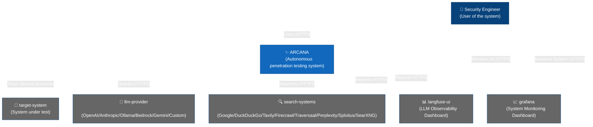
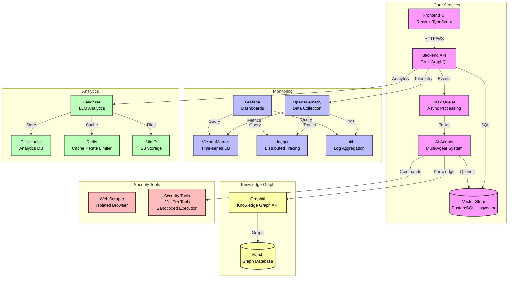
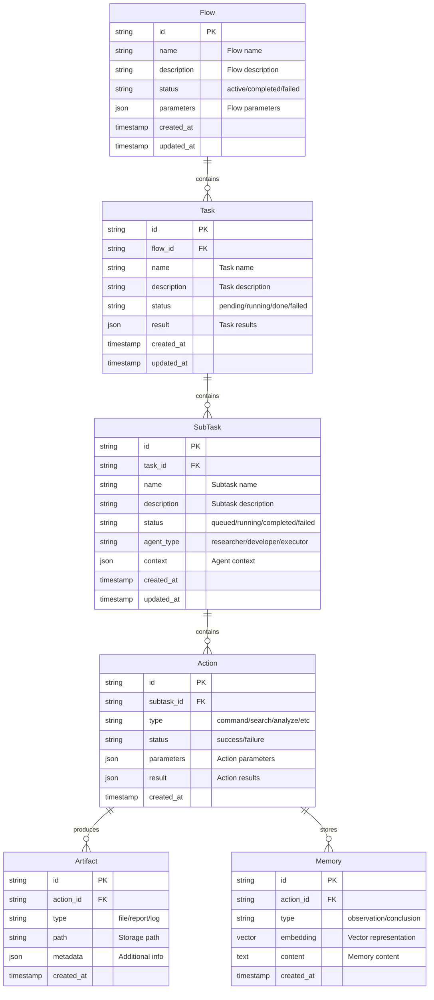
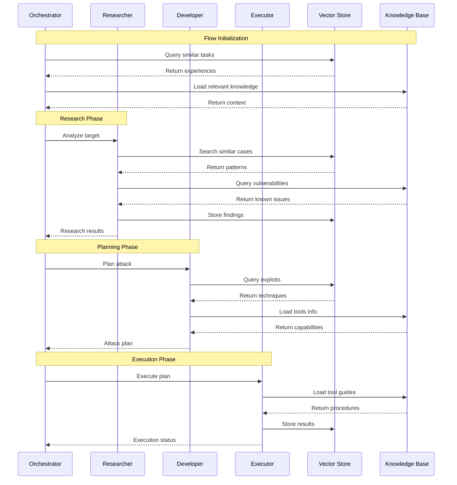
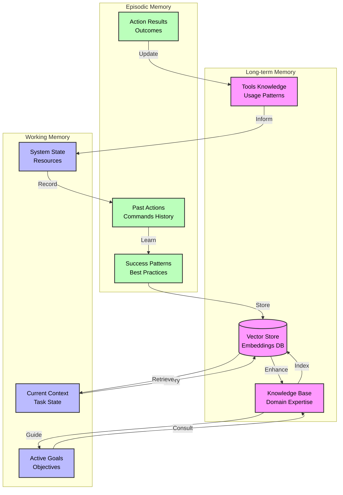
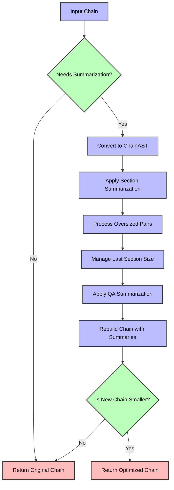

# Architecture

How ARCANA is put together: the system context, the container topology, the entity model, the agent interaction loop, the memory systems, chain summarization, and the supervision mechanisms that keep long-running flows on track.

## System Context



<details>
<summary><b>Container Architecture</b> (click to expand)</summary>



</details>

<details>
<summary><b>Entity Relationship</b> (click to expand)</summary>



</details>

<details>
<summary><b>Agent Interaction</b> (click to expand)</summary>



</details>

<details>
<summary><b>Memory System</b> (click to expand)</summary>



</details>

<details>
<summary><b>Chain Summarization</b> (click to expand)</summary>

The chain summarization system manages conversation context growth by selectively summarizing older messages. This is critical for preventing token limits from being exceeded while maintaining conversation coherence.



The algorithm operates on a structured representation of conversation chains (ChainAST) that preserves message types including tool calls and their responses. All summarization operations maintain critical conversation flow while reducing context size.

## Global Summarizer Configuration Options

| Parameter             | Environment Variable             | Default | Description                                                |
| --------------------- | -------------------------------- | ------- | ---------------------------------------------------------- |
| Preserve Last         | `SUMMARIZER_PRESERVE_LAST`       | `true`  | Whether to keep all messages in the last section intact    |
| Use QA Pairs          | `SUMMARIZER_USE_QA`              | `true`  | Whether to use QA pair summarization strategy              |
| Summarize Human in QA | `SUMMARIZER_SUM_MSG_HUMAN_IN_QA` | `false` | Whether to summarize human messages in QA pairs            |
| Last Section Size     | `SUMMARIZER_LAST_SEC_BYTES`      | `51200` | Maximum byte size for last section (50KB)                  |
| Max Body Pair Size    | `SUMMARIZER_MAX_BP_BYTES`        | `16384` | Maximum byte size for a single body pair (16KB)            |
| Max QA Sections       | `SUMMARIZER_MAX_QA_SECTIONS`     | `10`    | Maximum QA pair sections to preserve                       |
| Max QA Size           | `SUMMARIZER_MAX_QA_BYTES`        | `65536` | Maximum byte size for QA pair sections (64KB)              |
| Keep QA Sections      | `SUMMARIZER_KEEP_QA_SECTIONS`    | `1`     | Number of recent QA sections to keep without summarization |

## Assistant Summarizer Configuration Options

Assistant instances can use customized summarization settings to fine-tune context management behavior:

| Parameter          | Environment Variable                    | Default | Description                                                          |
| ------------------ | --------------------------------------- | ------- | -------------------------------------------------------------------- |
| Preserve Last      | `ASSISTANT_SUMMARIZER_PRESERVE_LAST`    | `true`  | Whether to preserve all messages in the assistant's last section     |
| Last Section Size  | `ASSISTANT_SUMMARIZER_LAST_SEC_BYTES`   | `76800` | Maximum byte size for assistant's last section (75KB)                |
| Max Body Pair Size | `ASSISTANT_SUMMARIZER_MAX_BP_BYTES`     | `16384` | Maximum byte size for a single body pair in assistant context (16KB) |
| Max QA Sections    | `ASSISTANT_SUMMARIZER_MAX_QA_SECTIONS`  | `7`     | Maximum QA sections to preserve in assistant context                 |
| Max QA Size        | `ASSISTANT_SUMMARIZER_MAX_QA_BYTES`     | `76800` | Maximum byte size for assistant's QA sections (75KB)                 |
| Keep QA Sections   | `ASSISTANT_SUMMARIZER_KEEP_QA_SECTIONS` | `3`     | Number of recent QA sections to preserve without summarization       |

The assistant summarizer configuration provides more memory for context retention compared to the global settings, preserving more recent conversation history while still ensuring efficient token usage.

## Summarizer Environment Configuration

```bash
# Default values for global summarizer logic
SUMMARIZER_PRESERVE_LAST=true
SUMMARIZER_USE_QA=true
SUMMARIZER_SUM_MSG_HUMAN_IN_QA=false
SUMMARIZER_LAST_SEC_BYTES=51200
SUMMARIZER_MAX_BP_BYTES=16384
SUMMARIZER_MAX_QA_SECTIONS=10
SUMMARIZER_MAX_QA_BYTES=65536
SUMMARIZER_KEEP_QA_SECTIONS=1

# Default values for assistant summarizer logic
ASSISTANT_SUMMARIZER_PRESERVE_LAST=true
ASSISTANT_SUMMARIZER_LAST_SEC_BYTES=76800
ASSISTANT_SUMMARIZER_MAX_BP_BYTES=16384
ASSISTANT_SUMMARIZER_MAX_QA_SECTIONS=7
ASSISTANT_SUMMARIZER_MAX_QA_BYTES=76800
ASSISTANT_SUMMARIZER_KEEP_QA_SECTIONS=3
```

</details>

<a id="advanced-agent-supervision"></a>
<details>
<summary><b>Advanced Agent Supervision</b> (click to expand)</summary>

ARCANA includes sophisticated multi-layered agent supervision mechanisms to ensure efficient task execution, prevent infinite loops, and provide intelligent recovery from stuck states:

## Execution Monitoring (Beta)
- **Automatic Mentor Intervention**: Adviser agent (mentor) is automatically invoked when execution patterns indicate potential issues
- **Pattern Detection**: Monitors identical tool calls (threshold: 5, configurable) and total tool calls (threshold: 10, configurable)
- **Progress Analysis**: Evaluates whether agent advances toward subtask objective, detects loops and inefficiencies
- **Alternative Strategies**: Recommends different approaches when current strategy fails
- **Information Retrieval Guidance**: Suggests searching for established solutions instead of reinventing
- **Enhanced Response Format**: Tool responses include both `<original_result>` and `<mentor_analysis>` sections
- **Configurable**: Enable via `EXECUTION_MONITOR_ENABLED` (default: false), customize thresholds with `EXECUTION_MONITOR_SAME_TOOL_LIMIT` and `EXECUTION_MONITOR_TOTAL_TOOL_LIMIT`

**Best for**: Smaller models (< 32B parameters), complex attack scenarios requiring continuous guidance, preventing agents from getting stuck on single approach

**Performance Impact**: 2-3x increase in execution time and token usage, but delivers **2x improvement in result quality** based on testing with Qwen3.5-27B-FP8

## Intelligent Task Planning (Beta)
- **Automated Decomposition**: Planner (adviser in planning mode) generates 3-7 specific, actionable steps before specialist agents begin work
- **Context-Aware Plans**: Analyzes full execution context via enricher agent to create informed plans
- **Structured Assignment**: Original request wrapped in `<task_assignment>` structure with execution plan and instructions
- **Scope Management**: Prevents scope creep by keeping agents focused on current subtask only
- **Enriched Instructions**: Plans highlight critical actions, potential pitfalls, and verification points
- **Configurable**: Enable via `AGENT_PLANNING_STEP_ENABLED` (default: false)

**Best for**: Models < 32B parameters, complex penetration testing workflows, improving success rates on sophisticated tasks

**Enhanced Adviser Configuration**: Works exceptionally well when adviser agent uses stronger model or enhanced settings. Example: using same base model with maximum reasoning mode for adviser (see [`vllm-qwen3.5-27b-fp8.provider.yml`](../../examples/configs/vllm-qwen3.5-27b-fp8.provider.yml)) enables comprehensive task analysis and strategic planning from identical model architecture.

**Performance Impact**: Adds planning overhead but significantly improves completion rates and reduces redundant work

## Tool Call Limits (Always Active)
- **Hard Limits**: Prevent runaway executions regardless of supervision mode status
- **Differentiated by Agent Type**:
  - General agents (Assistant, Primary Agent, Pentester, Coder, Installer): `MAX_GENERAL_AGENT_TOOL_CALLS` (default: 100)
  - Limited agents (Searcher, Enricher, Memorist, Generator, Reporter, Adviser, Reflector, Planner): `MAX_LIMITED_AGENT_TOOL_CALLS` (default: 20)
- **Graceful Termination**: Reflector guides agents to proper completion when approaching limits
- **Resource Protection**: Ensures system stability and prevents resource exhaustion

## Reflector Integration (Always Active)
- **Automatic Correction**: Invoked when LLM fails to generate tool calls after 3 attempts
- **Strategic Guidance**: Analyzes failures and guides agents toward proper tool usage or barrier tools (`done`, `ask`)
- **Recovery Mechanism**: Provides contextual guidance based on specific failure patterns
- **Limit Enforcement**: Coordinates graceful termination when tool call limits are reached

## Recommendations for Open Source Models

**Must-Have for Models < 32B Parameters**:
Testing with Qwen3.5-27B-FP8 demonstrates that enabling both Execution Monitoring and Task Planning is **essential** for smaller open source models:
- **Quality Improvement**: 2x better results compared to baseline execution without supervision
- **Loop Prevention**: Significantly reduces infinite loops and redundant work
- **Attack Diversity**: Encourages exploration of multiple attack vectors instead of fixating on single approach
- **Air-Gapped Deployments**: Enables production-grade autonomous pentesting in closed network environments with local LLM inference

**Trade-offs**:
- Token consumption: 2-3x increase due to mentor/planner invocations
- Execution time: 2-3x longer due to analysis and planning steps
- Result quality: 2x improvement in completeness, accuracy, and attack coverage
- Model requirements: Works best when adviser uses enhanced configuration (higher reasoning parameters, stronger model variant, or different model)

**Configuration Strategy**:
For optimal performance with smaller models, configure adviser agent with enhanced settings:
- Use same model with maximum reasoning mode (example: [`vllm-qwen3.5-27b-fp8.provider.yml`](../../examples/configs/vllm-qwen3.5-27b-fp8.provider.yml))
- Or use stronger model for adviser while keeping base model for other agents
- Adjust monitoring thresholds based on task complexity and model capabilities


</details>

The architecture of ARCANA is designed to be modular, scalable, and secure. Here are the key components:

1. **Core Services**
   - Frontend UI: React-based web interface with TypeScript for type safety
   - Backend API: Go-based REST and GraphQL APIs with Bearer token authentication for programmatic access
   - Vector Store: PostgreSQL with pgvector for semantic search and memory storage
   - Task Queue: Async task processing system for reliable operation
   - AI Agent: Multi-agent system with specialized roles for efficient testing

2. **Optional Knowledge Graph**
   - Graphiti: Knowledge graph API for semantic relationship tracking and contextual understanding
   - Neo4j: Graph database for storing and querying relationships between entities, actions, and outcomes
   - When enabled, automatically captures agent responses and tool executions for a flow-scoped knowledge base

3. **Monitoring Stack**
   - OpenTelemetry: Unified observability data collection and correlation
   - Grafana: Real-time visualization and alerting dashboards
   - VictoriaMetrics: High-performance time-series metrics storage
   - Jaeger: End-to-end distributed tracing for debugging
   - Loki: Scalable log aggregation and analysis

4. **Analytics Platform**
   - Langfuse: Advanced LLM observability and performance analytics
   - ClickHouse: Column-oriented analytics data warehouse
   - Redis: High-speed caching and rate limiting
   - MinIO: S3-compatible object storage for artifacts

5. **Security Tools**
   - Web Scraper: Isolated browser environment for safe web interaction
   - Pentesting Tools: Comprehensive suite of 20+ professional security tools
   - Sandboxed Execution: All operations run in isolated containers

6. **Memory Systems**
   - Long-term Memory: Persistent storage of knowledge and experiences
   - Working Memory: Active context and goals for current operations
   - Episodic Memory: Historical actions and success patterns
   - Knowledge Base: Structured domain expertise and tool capabilities
   - Context Management: Intelligently manages growing LLM context windows using chain summarization

The system uses Docker containers for isolation and easy deployment, with separate networks for core services, monitoring, and analytics to ensure proper security boundaries. Each component is designed to scale horizontally and can be configured for high availability in production environments.
